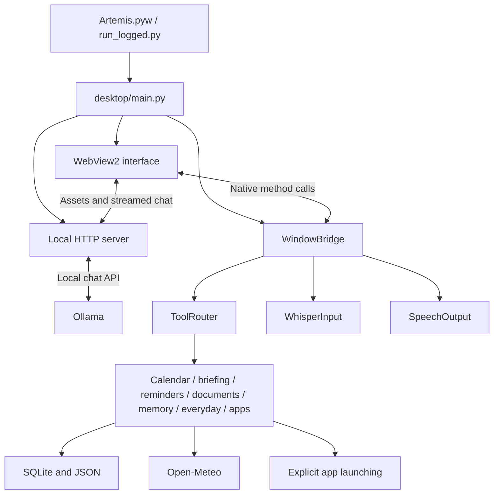

# Artemis architecture

Current application structure, updated 29 October 2026. All source paths below are relative to `app/`; an installed copy places those files directly in its application folder.

## System boundaries

Artemis is a Windows desktop application with three cooperating parts: a WebView2 interface, Python desktop services, and a local Ollama service. Voice models and personal data are separate from the source distribution.

The chat server does not execute Windows commands. Model-generated text cannot invoke arbitrary tools or write personal memory directly.

## Startup and interface

1. `Artemis.pyw` starts `run_logged.py` without a console window.
2. The launcher takes a single-instance file lock and opens a local diagnostic log.
3. `desktop/main.py` constructs the services, starts a server bound to localhost on an assigned port, and opens the WebView2 window.
4. The interface restores saved preferences and bounded conversation history through the native bridge.
5. Recording, model preparation, and synthesis start only through their respective controls. New installations start with Quiet mode on and hands-free off.

The interface lives in `desktop/web/`. Full, Mini, and compact chat layouts share the same services. Reply fragments are coalesced per animation frame. Closed panels skip rendering, and decorative animation pauses while a panel is open.

## Text request flow

The interface sends a message to `WindowBridge.handle_command`. The deterministic router checks tools in this order:

1. Imported calendar queries.
2. Daily briefing.
3. Reminders.
4. Indexed documents.
5. Explicit personal memory.
6. Everyday weather, date/time, arithmetic, and help.
7. Explicit app launching.

A handled response includes display text and may include sources, choices, or a confirmation token. A handled response can still report a failure; task plans check success before advancing. Unrecognized text continues to the local HTTP chat endpoint.

The chat server retrieves relevant saved facts/document excerpts, treats them as untrusted reference material, and streams the selected Ollama model's answer to the interface. Citations are model output and require judgment; retrieval and prompt instructions do not guarantee correctness. Stop reply cancels the client stream. Upstream computation may continue until cancellation is detected or a read timeout expires.

## Tools and storage

| Component | Responsibility |
| --- | --- |
| `tool_router.py` | Ordered, bounded deterministic dispatch |
| `personal_memory.py` | Explicit fact creation, search, update, and deletion |
| `document_search.py` / `document_extract.py` | Selected-file snapshots, FTS5 search, and source locators |
| `reminders.py` | Persistent one-time reminders and acknowledgement |
| `calendar_store.py` | Imported `.ics` snapshots and event expansion |
| `daily_briefing.py` / `briefing_schedule.py` | Combined briefing and opt-in daily visual notice |
| `local_time.py` | Rule-aware local-day calculations, including DST |
| `app_launcher.py` | Installed-app discovery, matching, and confirmation |
| `task_plans.py` | Reviewed sequences of supported deterministic tasks |
| `model_settings.py` | Persisted Ollama model selection |
| `desktop_state.py` | Validated preferences and up to 100 saved conversation messages |
| `performance_log.py` | Bounded in-memory timings without message/audio content |

State is stored under the application folder's `data/` directory using SQLite and JSON. Logs are stored under `logs/`. Data is not encrypted by the application. Removing an indexed document snapshot does not delete its original file; clearing chat does not delete memory or indexed documents.

## Voice flow

`WhisperInput` captures audio through sounddevice and transcribes with faster-whisper. The default model is cached `base.en` on CPU with int8 computation. Model/device configuration can be overridden; missing models are not downloaded automatically during ordinary recording.

`SpeechOutput` prepares Kokoro first, with Piper fallback, and plays through an owned output stream. Stop speaking interrupts the owned stream and suppresses pending playback after synthesis. Quiet mode blocks recording and spoken replies and stops current speech.

Hands-free mode waits for a speech endpoint, submits the transcript, waits for the answer and playback, then starts the next turn. It is opt-in and is not a wake-word service. Cached voice-model preparation is also explicit and does not capture, play, or download audio/models.

Microphone and output quality depend on model availability, hardware, drivers, and resource pressure. See the [validation status](README.md#validation--next-steps).

## Reviewed task plans

A plan contains two to four supported steps and requires a Run click. Read operations run in sequence; an app launch can appear only as the final step. Ambiguous matches require a separate confirmation. Memory writes, reminder creation, arbitrary shell commands, and model-directed execution are not supported inside plans.

Failure stops subsequent steps. Cancel prevents later steps after an in-flight operation returns; it does not undo completed work. Plans are temporary and are not executable again merely because their chat text was restored.

## Concurrency and external services

The native window runs on its GUI thread. The local HTTP server and voice workers use background threads. Locks coordinate shared state and cancellation; status updates are polled by the interface. JSON state uses atomic replacement.

| Service | When used | Information exchanged |
| --- | --- | --- |
| Local Ollama | General conversation and model/service checks | Messages, recent context, relevant saved facts/excerpts |
| Open-Meteo | Location search and weather requests | City search text, selected coordinates, weather results |
| Package/model providers | Explicit installation and model preparation | Download requests |

Calendar support imports local files; it does not connect to a calendar account. Email integration is not implemented. Reminders and scheduled briefings are application services and require Artemis to be open, rather than OS background tasks.

## Packaging and development

`scripts/build.py` creates a deterministic source ZIP and SHA-256 manifest. The guided installer verifies the manifest, copies application files into a new folder, creates a private Python environment, and installs direct pinned dependencies. It leaves system prerequisites and model preparation as explicit setup steps.

Model weights, Python environments, private data, logs, and rollback backups are excluded from the source bundle. The repository's earlier layout remains in Git history. Use `app/` for current changes and the [development guide](docs/DEVELOPMENT.md) for checks and packaging.
