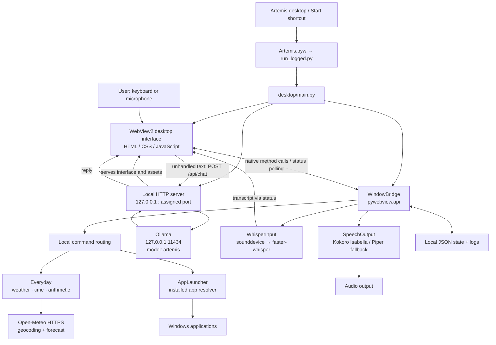
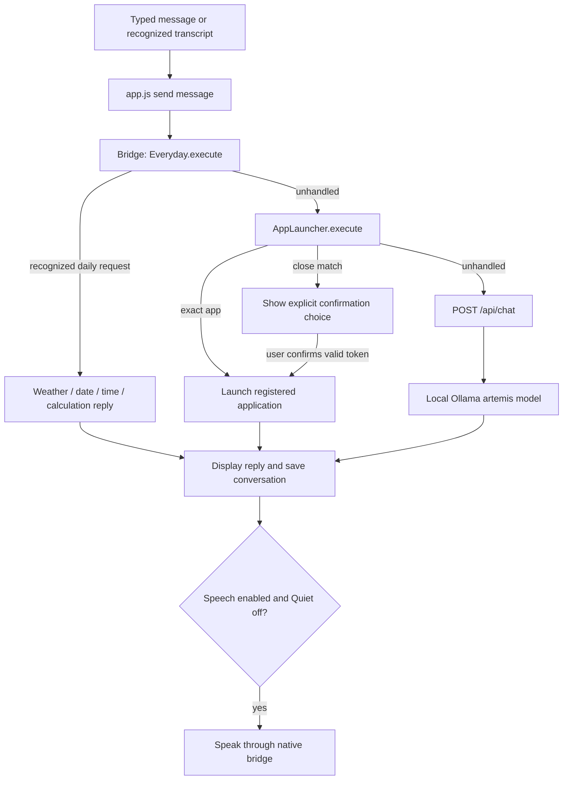
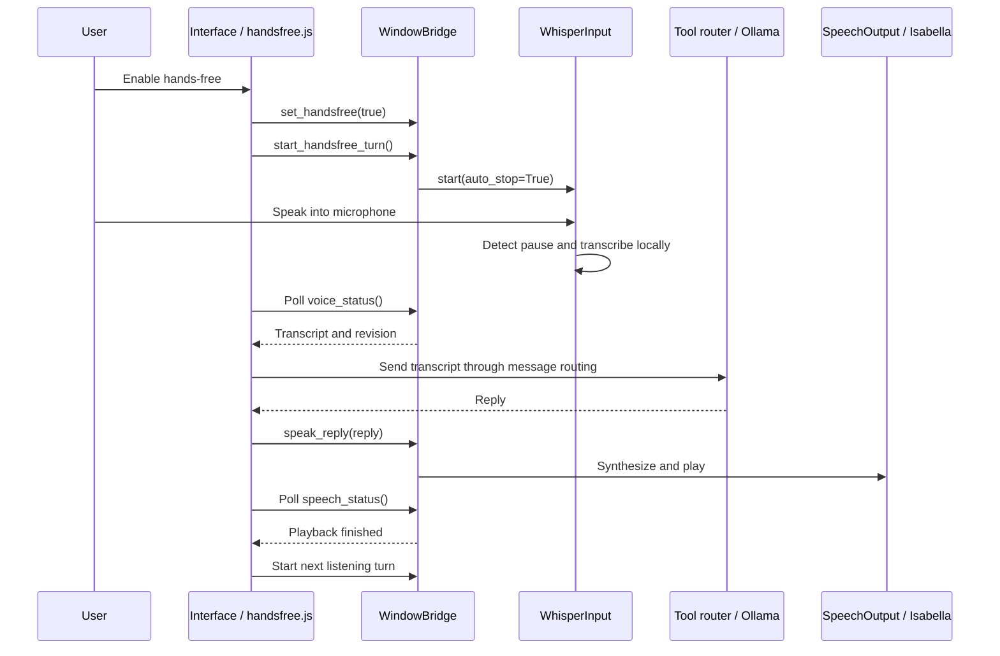

# Artemis project architecture

Inspected against the installed application on 23 October 2026.

## 1. System overview

Artemis is a Windows desktop assistant. HTML/CSS/JavaScript runs inside Microsoft Edge WebView2; Python owns microphone access, speech, Windows controls, app launching and everyday tools. General conversation uses a local Ollama model. Live weather uses Open-Meteo over the internet.

There are two communication paths: browser requests to the local HTTP server for chat/assets, and the native pywebview bridge for desktop capabilities. The HTTP chat server does not execute Windows commands.

## 2. Startup and window lifecycle

1. The Artemis shortcut starts the virtual environment's `pythonw.exe` with `Artemis.pyw`.
2. `Artemis.pyw` sets the working directory and invokes `run_logged.py`.
3. `run_logged.py` takes a single-instance file lock and redirects diagnostics into a timestamped log.
4. `desktop/main.py` starts a localhost-only threaded HTTP server on an available port.
5. It creates `WindowBridge` and a frameless, resizable pywebview window, explicitly using Edge Chromium/WebView2.
6. WebView2 loads `desktop/web/index.html`; JavaScript restores saved preferences and conversation.
7. Native window operations are marshalled onto the Windows UI thread. Closing the app attempts to flush saved state; the server shuts down when the desktop exits.

Full, Mini and compact chat are modes of the same native window. Mini pinning and position are handled by Python. Hands-free starts OFF on every launch.

## 3. Main components

Paths below are relative to `C:\Users\kanag\Desktop\Artemis`.

| Component | File | Responsibility |
|---|---|---|
| Launcher | `Artemis.pyw` | Console-free application entry and startup error dialog |
| Diagnostics | `run_logged.py` | Single-instance lock, stdout/stderr logs, fault diagnostics |
| Desktop host | `desktop/main.py` | WebView2 setup, bridge, window controls, service coordination |
| Local web server | `desktop/server.py` | Static assets, health endpoint, validated Ollama chat proxy |
| Main interface | `desktop/web/app.js` | Chat interaction, command routing, voice status, display states |
| Presentation | `desktop/web/index.html`, CSS files | Layout, settings, panels, theme and responsive styling |
| Animated identity | `desktop/web/icon-mode.js` | Artemis icon animation and mode appearance |
| Session | `desktop/web/session.js` | Restore/save preferences and conversation, Quiet behavior |
| Mini interface | `desktop/web/mini.js` | Full/Mini/chat controls and compact layouts |
| Custom window chrome | `desktop/web/window-chrome.js` | Minimize, maximize/restore, close and dragging UI |
| Hands-free controller | `desktop/web/handsfree.js` | Repeated listening turns, playback wait, status and stopping |
| App settings | `desktop/web/app-commands.js` | Installed app discovery UI |
| Everyday settings | `desktop/web/daily.js` | Weather city lookup and selection UI |
| Recognition | `desktop/whisper_input.py` | Capture audio, load faster-whisper, transcribe, expose status |
| End-of-turn detection | `desktop/speech_endpoint.py` | RMS/noise-based speech and pause detection |
| Speech coordinator | `desktop/speech_output.py` | Enable/mute speech, background speech worker, playback status |
| Speech engine | `artemis/voice.py` | Kokoro Isabella synthesis, Piper fallback and audio playback |
| App commands | `desktop/app_launcher.py` | Parse explicit launch requests, match apps, confirmation tokens |
| App discovery | `artemis/artemis_app_resolver_723.py` | Reused Windows installed-app/shortcut resolver |
| Everyday tools | `desktop/everyday.py` | Weather, city selection, date/time, bounded arithmetic, capability help |
| Saved session | `desktop/desktop_state.py` | Validate and atomically save bounded preferences/history |

## 4. Request routing

Deterministic tools run before the language model. The model is conversational; it does not decide which raw operating-system command to execute. Ambiguous app matches require a clickable confirmation with an expiring, single-use token.

Weather uses the saved city and a five-minute cache. City searches use Open-Meteo geocoding; forecasts use the selected coordinates. Today/tomorrow are supported. Failed retrieval reports an error instead of inventing weather.

## 5. Voice and hands-free flow

Manual recording uses the same capture/transcription service: click to start, click again to stop and transcribe. Auto-send controls whether a recognized transcript is immediately submitted.

Whisper defaults in code are `base.en`, CPU and int8; environment variables may override the model and device. Models are loaded lazily. Hands-free uses pause detection, checks that the transcript has been consumed, and waits for speech playback before recording again. Quiet mode blocks new recording and spoken replies. Audio already playing may finish.

## 6. Data and external dependencies

| Location/service | Stored or exchanged information |
|---|---|
| `data/desktop-state.json` | Preferences and bounded conversation history: up to 100 messages |
| `data/mini-window.json` | Mini position and pin preference |
| `data/everyday.json` | Selected weather city and coordinates |
| `logs/desktop-*.log` | Runtime diagnostics and errors |
| `logs/desktop.lock` | Single-instance locking file |
| `desktop/assets/` | App icon and visual assets |
| `models/`, `voice_test/`, model caches | Speech model assets; actual lookup depends on engine/configuration |
| Ollama localhost API | Conversation text and recent context |
| Open-Meteo HTTPS APIs | City search text, selected coordinates, returned weather |
| `ui-backups/` | Rollback snapshots from installed updates |

Microphone transcription and speech synthesis run locally with installed models. General chat requires the local Ollama service. Live weather requires internet. Local JSON files are ordinary application files; the architecture does not provide encrypted conversation storage.

## 7. Threading and stability boundaries

- The native WebView2 window runs on the GUI thread. Bridge window operations use `_on_ui_thread` rather than directly touching native window properties from worker threads.
- The HTTP server runs in a background thread and handles requests with `ThreadingHTTPServer`.
- Audio capture/transcription and speech synthesis/playback run in background workers. The interface polls status and revision numbers.
- Locks coordinate hands-free changes, shared state and Mini persistence; JSON state writes use atomic replacement.
- Bridge service objects are private fields. Public bridge members are callable methods, avoiding recursive exposure of native window objects.
- Startup and runtime logs support crash diagnosis. These controls reduce known failure modes; they are not a guarantee against WebView2, audio-driver or model failures.

## 8. Current project versus historical versions

The active installation is the top-level `desktop/` under `C:\Users\kanag\Desktop\Artemis`. The tree also contains older desktop copies, experimental orb/voice modules and staged backups. Their presence does not mean the current launcher uses them.

`C:\Users\kanag\Documents\ChatGPT\Artemis` is the development/update workspace. Its `Artemis-*` directories and ZIP files are successive feature packages, not separate services. `Artemis-Daily` is the latest staged everyday-feature package inspected here.

The current centerpiece is the animated Artemis icon. Older WebGL shader files remain available, but icon mode bypasses the old WebGL orb initialization. Several generations of CSS are still loaded in order, with later files overriding earlier styling.

## 9. Sensible next architectural improvements

These are recommendations, not implemented features:

1. Rename `handle_app_command` to a general command router and give tools a consistent response structure (`handled`, display text, spoken text, choices, source metadata).
2. Separate natural spoken weather text from the timestamp/source details shown in chat. Currently the same reply string is displayed and spoken.
3. Consolidate the layered theme files and remove unused scripts only after visual/regression checks and a rollback snapshot.
4. Establish one canonical source tree with version control and reproducible packaging; clearly archive historical copies.
5. Centralize the conversation state machine to reduce coordination through shared JavaScript globals across chat, recording and playback.

Existing checks in the development workspace cover command matching, weather errors, arithmetic bounds, hands-free behavior, saved state, Mini behavior and selected native window operations. This document was checked against source; no microphone recording, audio playback or app restart was needed to produce it.
