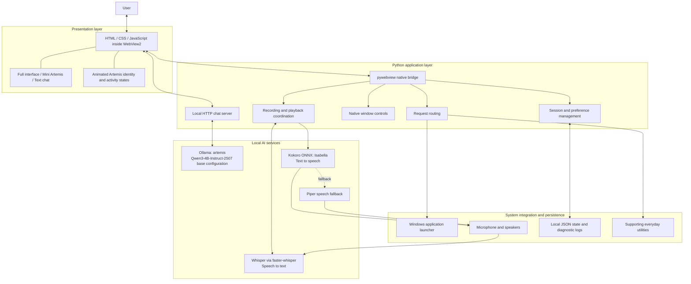

# Artemis: System Architecture and AI Models

## Project overview

Artemis is an offline-first Windows desktop AI assistant designed for text conversation, voice interaction and controlled desktop actions. It combines a local language model, speech recognition and speech synthesis within a borderless desktop interface. Supporting utilities can retrieve external information when internet access is required.

The system separates presentation, coordination, AI inference and operating-system integration. This allows each component to be developed or replaced independently.

## Architecture diagram

## Main features

### 1. Contextual text conversation

Users can ask questions and receive explanations through the chat interface. JavaScript sends general conversation to a localhost Python HTTP server, which validates the request and forwards it to Ollama. Ollama runs the local language model and returns a response. Recent messages provide conversational context; saved history allows the interface to restore previous messages.

Saved history is bounded application storage, not a trained memory system or a retrieval-augmented knowledge base. The complete stored conversation is not sent on every model request.

### 2. Voice interaction

Microphone audio is captured using `sounddevice` and transcribed through `faster-whisper`. The transcript becomes a normal user message, so voice and text share the same command and conversation pipeline.

Replies can be converted to speech using Kokoro with the Isabella voice. Piper provides a fallback when its required model is available and Kokoro cannot be used. Recognition, synthesis and playback run in background workers to keep the interface responsive.

### 3. Hands-free conversation

After explicit activation, Artemis records a turn, detects a pause, transcribes speech, processes the request and speaks the reply. It waits for playback to finish before starting the next recording.

The end-of-turn detector uses audio energy and timing rules. It is not a separate neural model. Hands-free starts disabled on each launch; the current desktop flow does not depend on always-on wake-word detection.

### 4. Controlled application launching

Explicit commands such as “open Notepad” are processed by a Python application launcher. It discovers installed applications and registered shortcuts, matches the requested application, and launches supported targets. Ambiguous matches require confirmation.

This component is rule-based. The language model does not generate and execute arbitrary shell commands. The application controller reports whether the action succeeded.

### 5. Mini Artemis and desktop integration

The interface supports full-size, Mini and compact chat modes using the same native window. Python manages resizing, positioning and pinning. A custom title area provides borderless window controls.

The animated Artemis icon reflects states such as listening, processing and speaking. The current icon animation is a presentation component, not an AI model; older WebGL orb implementations remain in the project but are bypassed in icon mode.

### 6. Quiet mode and persistent settings

Quiet mode blocks new microphone recording and spoken replies while retaining text interaction. Preferences, bounded chat history and Mini-window settings are saved locally in JSON files. Audio already playing may finish after Quiet mode is enabled.

### 7. Supporting utilities

Additional deterministic tools provide date/time, bounded arithmetic and live information such as weather. These extend the assistant's usefulness but are secondary to its conversation, voice and desktop-control architecture. External information services require internet access.

## Important AI models and runtimes

| Function | Model / configuration | Runtime | Role |
|---|---|---|---|
| Conversational intelligence | Qwen3-4B-Instruct-2507 base configuration; configured source `kamekichi128/qwen3-4b-instruct-2507` | Ollama, served under the name `artemis` | Generates conversational answers and explanations |
| Speech recognition | Whisper `base.en` by default; code also supports `small.en` and `medium.en` | `faster-whisper` | Converts microphone speech into English text |
| Primary speech synthesis | Kokoro v1.0, with voice identifier `bf_isabella` | `kokoro-onnx` | Converts reply text into Isabella's spoken voice |
| Fallback speech synthesis | Piper with an available local voice model; code describes the fallback as Alba | Piper | Provides speech if the primary engine is unavailable |

The project `ModelFile` specifies the Qwen base, temperature `0.7` and a context setting of `4096`. `artemis` is an Ollama model name/configuration, not evidence that a new foundation model was trained. The base configuration is verified from the project file; the live Ollama model manifest was not inspected for this document.

Whisper defaults to CPU execution with int8 computation. Configuration can select CUDA with float16 and a different supported Whisper size. These are code defaults and supported options, not a claim about the environment of every running session.

Kokoro uses `kokoro-v1.0.onnx` and `voices-v1.0.bin`. Isabella is a selected voice within that speech system, not the conversational language model. Ollama, faster-whisper and ONNX are execution technologies; they serve different model types.

## End-to-end processing

1. The user types a message or records speech.
2. For voice input, Whisper produces a text transcript.
3. The interface asks the Python command router whether a supported tool can handle the text.
4. A recognized tool request is executed by the corresponding service. An unhandled request is forwarded through the local server to Ollama.
5. The result is displayed and added to the saved conversation.
6. If speech is enabled and Quiet mode is off, Kokoro/Isabella generates the spoken response, with Piper available as a fallback.
7. If hands-free remains enabled, the next recording begins after playback finishes.

## Main implementation modules

Paths are relative to the installed Artemis project directory.

| Module | Responsibility |
|---|---|
| `Artemis.pyw` | Console-free entry point |
| `run_logged.py` | Single-instance protection and diagnostic logging |
| `desktop/main.py` | Desktop host, native bridge and service coordination |
| `desktop/server.py` | Local interface server and Ollama chat proxy |
| `desktop/web/` | Interface, animation, chat, hands-free and Mini controls |
| `desktop/whisper_input.py` | Audio capture and transcription |
| `desktop/speech_endpoint.py` | Pause-based end-of-turn detection |
| `desktop/speech_output.py` | Speech worker and playback status |
| `artemis/voice.py` | Kokoro and Piper speech engines |
| `desktop/app_launcher.py` | Explicit app-command matching and launching |
| `artemis/artemis_app_resolver_723.py` | Installed Windows application discovery |
| `desktop/desktop_state.py` | Validated preferences and chat persistence |
| `desktop/everyday.py` | Supporting utilities |

## Reliability and privacy boundaries

Native window operations are dispatched to the Windows UI thread. Audio and network operations use background execution, and shared state uses locks where required. JSON state is saved using atomic replacement. Diagnostic logs and update backups support troubleshooting and rollback.

Conversation, speech recognition and speech generation are designed to operate locally with installed models and services. Supporting online tools can transmit the information needed for their requests. Local conversation files are not encrypted by the application. This is an offline-first architecture, rather than a guarantee that every capability works without internet.

## Architectural contribution

Artemis integrates separate AI models and desktop services into a single assistant. Its principal engineering contribution is the coordinated interaction between local language generation, speech recognition, speech synthesis, controlled application actions and a responsive desktop interface. It uses existing pretrained models; the project does not establish that those models were trained from scratch.
