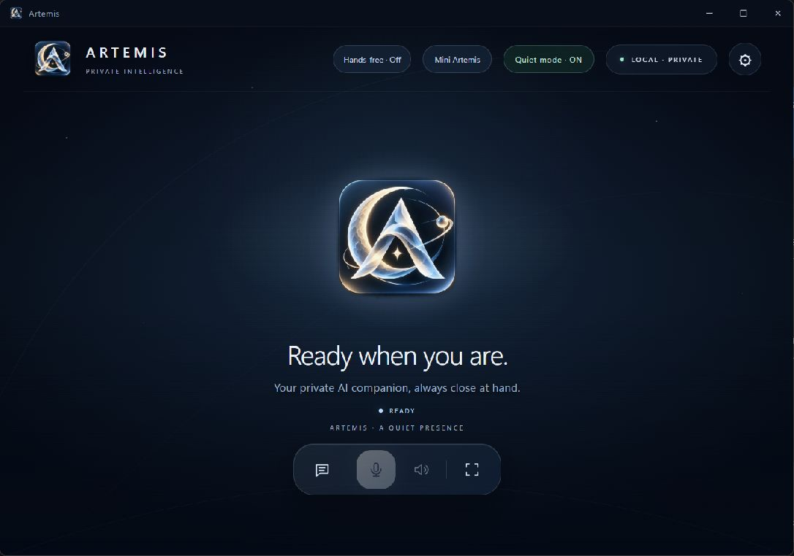
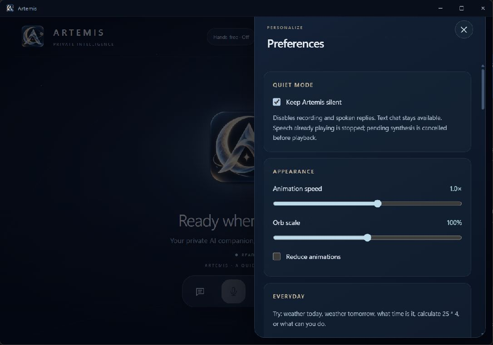
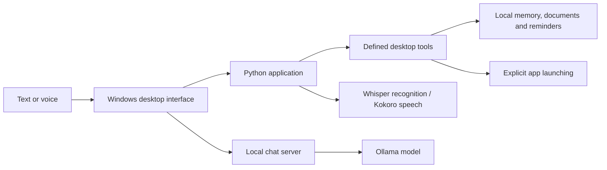

<div align="center">


# Artemis

**A Windows desktop assistant for local AI, voice, and everyday tasks.**

Chat with a local model, find information in your documents, and manage reminders from one desktop interface.

**Windows x64 · Python · WebView2 · Ollama**

[Features](#features) · [Get started](#get-started) · [Usage guide](docs/USAGE.md) · [Architecture](ARCHITECTURE.md)

</div>



## Overview

Artemis brings local language models and practical desktop tools into a single Windows application. It supports text chat, local speech recognition and spoken replies, alongside explicit tools for documents, personal memory, reminders, calendars, weather, and app launching.

The interface includes a full desktop view, a compact Mini mode, and Quiet mode for text-only use. Desktop actions go through defined application tools; an AI-generated reply cannot execute a shell command or silently launch an app.

**Project status:** working prototype. The current app has passed automated regression checks, native Windows UI checks, real local-model chat checks, and silent voice-model loading. Clean-machine setup and live microphone use still need further validation.

## Features

| Area | What you can do |
| --- | --- |
| Local AI chat | Stream replies from Ollama, choose an installed model, and stop a reply. |
| Voice interaction | Use Whisper recognition and Kokoro speech, with Piper fallback. Push-to-talk and opt-in hands-free controls are available. |
| Personal memory | Explicitly save, find, update, and delete facts that can inform future replies. |
| Document search | Index selected text, Markdown, PDF, and Word files; retrieve excerpts with source locations. |
| Reminders | Create persistent one-time reminders and view overdue notices. |
| Daily briefings | Combine weather, reminders, and imported calendar events; optionally prepare a silent daily notice. |
| Calendar snapshots | Import `.ics` files, including supported recurring events. Reimport to refresh. |
| Desktop tasks | Launch installed apps through explicit commands and review supported multi-step plans before running them. |
| Interface & diagnostics | Use Mini mode, Quiet mode, appearance controls, service checks, and session timing information. |

Reminders and scheduled briefings require Artemis to be open. Calendar imports are snapshots rather than live account connections. Scanned PDFs require OCR, which is not included.

## A few things to try

```text
remember that I prefer tea
search documents for project budget
remind me in 10 minutes to stretch
calendar today
daily briefing
open Notepad
plan tasks: what time is it; calculate 25 * 4; open Notepad
```

Memory changes are explicit. Document search reads only files you select. Task plans show a preview and require a Run click; ambiguous app matches require confirmation.

See the [usage guide](docs/USAGE.md) for controls, command examples, and feature boundaries.

<details>
<summary><strong>See the Settings interface</strong></summary>



Screenshots show the actual application in an isolated preview with temporary settings. No personal conversations or documents are shown.

</details>

## How it works



The HTML/CSS/JavaScript interface runs inside WebView2. Python handles native controls, local storage, tool routing, and voice workers. General conversation uses a local Ollama endpoint; supported commands use deterministic handlers.

| Layer | Technology |
| --- | --- |
| Desktop & interface | Python, pywebview, Microsoft Edge WebView2, HTML, CSS, JavaScript |
| Local conversation | Ollama |
| Speech | faster-whisper, Kokoro ONNX, Piper, sounddevice |
| Storage & retrieval | SQLite, FTS5, local JSON settings |
| Documents & calendar | pypdf, Word document extraction, icalendar, recurring-ical-events |
| Live weather | Open-Meteo |

Read the [architecture guide](ARCHITECTURE.md) for request flows, storage, and execution boundaries.

## Get started

### Requirements

- Windows x64 and Python 3.11 x64.
- Microsoft Edge WebView2 Runtime for the desktop interface.
- Ollama and a locally installed chat model for conversation.
- Cached Whisper and Kokoro models for voice features.
- Internet access for initial package/model downloads and live weather.

### Guided setup

1. Clone or download this repository.
2. From its root, build the source distribution:

   ```powershell
   py -3.11 scripts/build.py
   ```

3. Extract `output/releases/artemis-source.zip` into a new folder. From the extracted folder, run:

   ```powershell
   .\scripts\install-windows.ps1
   ```

4. Follow the [Windows setup guide](setup/FIRST_RUN.md) to prepare WebView2, Ollama, and the voice models. Open the new `Artemis.lnk` shortcut when ready.

Setup creates a separate Python environment and refuses to overwrite an existing installation. New settings start with Quiet mode on, hands-free off, and scheduled briefings off. Model downloads are explicit.

This is a guided online setup. Python and model weights are not bundled in a standalone executable installer.

## Data & connectivity

Chat uses the local Ollama service. Speech recognition and synthesis run locally with cached models. Memory, indexed document snapshots, reminders, calendar snapshots, and conversation history are stored on the computer.

Live weather sends city searches and selected coordinates to Open-Meteo. Initial dependency/model downloads contact their respective providers. Local storage is not encrypted by Artemis; local processing does not make model answers inherently accurate.

## Validation & next steps

| Checked | Still to validate |
| --- | --- |
| Python and JavaScript regression suite | Installation on a clean second Windows computer |
| Native UI, settings, persistence, and tool integration | Live microphone/speaker use, accents, and background noise |
| Real Ollama chat and selected memory/document answer checks | Broader everyday task-plan and app-launch testing |
| Silent cached voice-model loading and in-memory speech round trips | Performance across a wider range of hardware |
| Reproducible source bundle with file hashes and runtime-data exclusions | |

These checks describe the current development results; they do not establish production readiness.

## Explore the project

| Path | Purpose |
| --- | --- |
| [`app/`](app/) | Current application source |
| [`setup/FIRST_RUN.md`](setup/FIRST_RUN.md) | Installation, models, and first-run checks |
| [`docs/USAGE.md`](docs/USAGE.md) | Everyday controls and commands |
| [`ARCHITECTURE.md`](ARCHITECTURE.md) | Current system design |
| [`docs/DEVELOPMENT.md`](docs/DEVELOPMENT.md) | Development, verification, and source packaging |
| [`tests/`](tests/) | Regression checks |
| [`docs/DEVELOPMENT_HISTORY.md`](docs/DEVELOPMENT_HISTORY.md) | Historical implementation notes |

## Development & feedback

Application changes belong in `app/`. Follow the [development guide](docs/DEVELOPMENT.md) to run checks and build a source distribution. For bug reports, include Windows/Python versions, reproduction steps, and a redacted error message. Do not post private chats, indexed documents, recordings, or model files.

Artemis builds on third-party runtimes, libraries, and models; their respective licenses apply. OpenJarvis was an ideas-only reference. Its code, assets, and documentation were not copied into this implementation.
